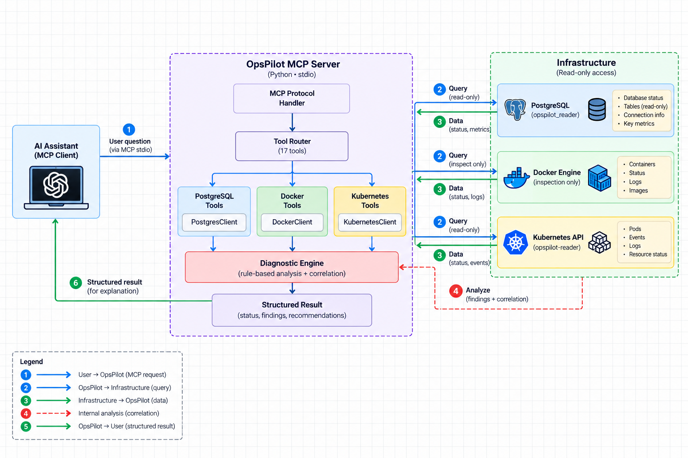

# OpsPilot MCP

OpsPilot MCP is a Model Context Protocol (MCP) server that provides a controlled bridge between an AI/MCP client and PostgreSQL, Docker, and Kubernetes. MCP lets an AI application request tools and receive results from external systems.

An AI may understand these technologies generally, but it does not automatically know what is happening in your infrastructure. OpsPilot supplies controlled observations and deterministic diagnostic findings so an AI client can explain problems using evidence from your systems. It does not autonomously repair infrastructure.

### What OpsPilot can do

- Inspect PostgreSQL connectivity, public tables, and query results.
- Inspect Docker containers, operational state, and recent logs.
- Inspect Kubernetes namespaces, pods, events, and recent pod logs.
- Run deterministic diagnostics over infrastructure observations.
- Correlate Kubernetes and PostgreSQL diagnostic findings.
- Return structured findings, evidence, and recommendations for an AI/MCP client to explain.

## Architecture



The data flow is: **AI/MCP client → OpsPilot MCP server → controlled tools/clients → PostgreSQL, Docker, Kubernetes → diagnostics → structured findings → AI/MCP client**. Observation tools can also return their results directly, without diagnostic analysis.

The server collects curated observations through backend clients. Deterministic rules interpret those observations; current cross-system correlation covers **Kubernetes + PostgreSQL only**. The AI client explains the returned evidence. Docker has an observation-only MCP/application tool surface; access to the Docker daemon itself is not read-only.

The supported deployment boundary is **trusted-local MCP over stdio**: a trusted local client launches the server and communicates through its standard input/output streams.

## Tech Stack

| Technology | Purpose |
| --- | --- |
| Python 3.11+ | Server, infrastructure clients, and diagnostics |
| MCP Python SDK (`mcp[cli]`) | Tool registration, protocol handling, and stdio transport |
| PostgreSQL | Database inspected by OpsPilot; PostgreSQL 17 in the demo |
| Psycopg 3 (`psycopg[binary]`) | PostgreSQL connections and queries |
| Docker / Docker SDK for Python | Container observations through the Docker Engine API |
| Docker Compose | Local PostgreSQL demo environment |
| Kubernetes / Kubernetes Python client | Cluster, pod, event, and log observations |
| kind / kubectl | Local Kubernetes cluster and reader provisioning |
| python-dotenv | Local PostgreSQL configuration loading |
| sqlparse | Screening queries for a single SELECT statement |
| pytest | Automated regression tests |
| Git / GitHub | Version control and repository hosting |

## Getting Started

Run the following commands from a local checkout. The examples use a POSIX shell.

### 1. Prerequisites

- Git and Python 3.11+ with virtual environment support.
- Docker Engine or Docker Desktop, Docker Compose, and permission to access the intended daemon.
- For Kubernetes tools: `kubectl`, a reachable cluster, and administrator access to provision the reader. Install kind to follow the local cluster example.
- PostgreSQL administrator access for provisioning, separate from the runtime reader identity. The Compose environment below supplies a local database.

Backend settings are loaded lazily: discovery does not connect to infrastructure. Configure each backend before invoking its tools; cross-system diagnostics require both Kubernetes and PostgreSQL.

### 2. Clone and install

```bash
git clone https://github.com/komolafetemitope14/opspilot-mcp.git
cd opspilot-mcp
python3 -m venv .venv
source .venv/bin/activate
python -m pip install -e '.[dev]'
cp .env.example .env
```

The editable installation includes runtime dependencies; the `dev` extra installs pytest.

### 3. Configure PostgreSQL

Edit the ignored `.env` locally using the variables in [.env.example](.env.example):

| Variable | Purpose |
| --- | --- |
| `POSTGRES_HOST`, `POSTGRES_PORT` | Database endpoint; demo defaults are `localhost` and `5432` |
| `POSTGRES_DB` | Database name; demo default is `opspilot` |
| `POSTGRES_ADMIN_USER`, `POSTGRES_ADMIN_PASSWORD` | Provisioning identity; also used to initialize the Compose database |
| `POSTGRES_USER`, `POSTGRES_PASSWORD` | Runtime reader credentials; provisioning requires `POSTGRES_USER=opspilot_reader` |

Choose private passwords for both identities and keep the administrator distinct from the reader. Exported variables override dotenv values. Never commit credentials, kubeconfigs, tokens, or private keys.

### 4. Start the demo database and provision its reader

For the included PostgreSQL demo:

```bash
docker compose up -d
docker compose ps
```

Wait until PostgreSQL is healthy, then provision the reader with the virtual environment active:

```bash
sh scripts/provision-postgres-reader.sh
```

For an existing database, skip Compose, configure its endpoint and administrator credentials, and run the same provisioning script after reviewing its grants.

The script configures `opspilot_reader` without superuser, database/role creation, replication, or RLS bypass attributes. It grants database CONNECT, `public` schema USAGE, and SELECT on existing public tables. Default SELECT grants cover future public tables created by `POSTGRES_ADMIN_USER`; other table owners need separate grants.

Provisioning does not revoke all existing authority: review memberships, ownership, other grants, PUBLIC privileges, functions, and RLS behavior. Database privileges are the authorization boundary; application SELECT screening and read-only transactions are additional controls.

Before launching OpsPilot, store administrator credentials separately and remove `POSTGRES_ADMIN_USER` and `POSTGRES_ADMIN_PASSWORD` from its runtime `.env` and inherited environment. Retain the five runtime fields above. Runtime connections never fall back to administrator fields, but credentials left in shared configuration remain accessible to the process. Restore administrator fields only for later provisioning or Compose commands that require them.

Compose uses a persistent named volume. Changing `.env` does not reset credentials in an existing database. A fresh demo database has no seeded application tables; empty table discovery and a `no_public_tables` diagnostic warning are expected.

### 5. Provision the Kubernetes reader

For a new local cluster:

```bash
kind create cluster --name opspilot
```

Use the administrator kubeconfig before selecting the runtime reader. The following assumes the kind administrator configuration is in your default kubeconfig:

```bash
unset KUBECONFIG
kubectl --context kind-opspilot get namespaces
sh scripts/provision-kubernetes-reader.sh --admin-context kind-opspilot
python scripts/verify-kubernetes-reader.py \
  --kubeconfig "$PWD/.local/kubernetes/opspilot-reader.kubeconfig"
export KUBECONFIG="$PWD/.local/kubernetes/opspilot-reader.kubeconfig"
```

For another cluster, use its administrator kubeconfig and replace `kind-opspilot` with its administrator context. Provision and verify before exporting the generated reader configuration.

The script applies [the reader RBAC manifest](kubernetes/opspilot-reader-rbac.yaml), creating an `opspilot-reader` ServiceAccount in `opspilot-system`. Its ClusterRole permits listing namespaces, getting/listing pods, getting pod logs, listing events, and reading `/api/v1`. It grants no Secret access, workload mutation, exec, attach, or port-forward access. Extra bindings can expand authority; the verifier checks effective identity, permissions, and observational read paths using cluster review APIs.

The generated token-only kubeconfig is ignored by Git, with directory/file modes of 0700/0600. Provisioning requests a one-hour token; the API server controls its actual lifetime. Renewal is manual: repeat provisioning with administrator credentials, verify, and relaunch OpsPilot. An expired token can produce HTTP 401; RBAC denial typically produces HTTP 403.

Runtime requires HTTPS and supported static kubeconfig credentials. Executable credential plugins and auth-provider plugins are unsupported.

### 6. Check Docker access

Start the intended Docker daemon and ensure the launching account can access it. OpsPilot resolves Docker environment/context settings, including `DOCKER_HOST`, `DOCKER_CONTEXT`, and applicable `DOCKER_TLS_VERIFY` / `DOCKER_CERT_PATH` settings. Review the selected endpoint and socket permissions.

Only observational operations are exposed as MCP tools. An unrestricted Docker socket still grants powerful daemon authority to the process; application restrictions do not isolate a compromised process from that authority.

### 7. Start OpsPilot and configure an MCP client

With the virtual environment active, the canonical command is:

```bash
python -m opspilot.server
```

This starts an MCP stdio process, normally launched and managed by your MCP client. A client using an `mcpServers` configuration can use:

```json
{
  "mcpServers": {
    "opspilot": {
      "command": "/absolute/path/opspilot-mcp/.venv/bin/python",
      "args": ["-m", "opspilot.server"]
    }
  }
}
```

Replace the executable path with your checkout's absolute path. Set the working directory to the repository root through your client's supported configuration, and supply the runtime PostgreSQL settings and absolute reader `KUBECONFIG` path through its environment mechanism. Client formats vary; GUI clients may not inherit your terminal environment. Keep provisioning credentials out of this launch configuration.

Current support is **trusted-local stdio only**. Remote HTTP deployment and authenticated multi-user access are not supported.

### 8. Run the tests

```bash
python -m pytest -v
```

See [Testing](#testing) for coverage and the distinction between regression tests and live authorization checks.

## MCP Tools

The server exposes 17 tools. Log tools default to `tail=100` and accept integers from 1 to 1,000. Docker identifiers must be bare container names or IDs.

### PostgreSQL

| Tool | Parameters | Purpose |
| --- | --- | --- |
| `postgres_health` | None | Check connectivity with `SELECT 1` |
| `postgres_list_tables` | None | List public-schema base tables |
| `postgres_query` | `query` | Run a single SELECT in a read-only transaction; return named rows |

### Docker

| Tool | Parameters | Purpose |
| --- | --- | --- |
| `docker_health` | None | Check Docker Engine connectivity |
| `docker_list_containers` | None | List running and stopped container summaries |
| `docker_inspect_container` | `name_or_id` | Inspect curated operational state, health, exit code, and ports |
| `docker_container_logs` | `name_or_id`, `tail=100` | Retrieve bounded recent container logs |

### Kubernetes

| Tool | Parameters | Purpose |
| --- | --- | --- |
| `kubernetes_health` | None | Check core Kubernetes API discovery |
| `kubernetes_list_namespaces` | None | List namespace names |
| `kubernetes_list_pods` | `namespace=None` | List pods in one namespace or all namespaces |
| `kubernetes_inspect_pod` | `name`, `namespace="default"` | Inspect a pod's operational state |
| `kubernetes_pod_logs` | `name`, `namespace="default"`, `tail=100` | Retrieve bounded recent pod logs |
| `kubernetes_list_events` | `namespace=None` | List curated events in one namespace or all namespaces |

### Diagnostics

| Tool | Parameters | Purpose |
| --- | --- | --- |
| `diagnose_postgres_issues` | None | Diagnose database health and public-table observations |
| `diagnose_docker_issues` | `name_or_id` | Diagnose one container's state and health |
| `diagnose_kubernetes_issues` | `name`, `namespace="default"` | Diagnose one pod and its related events |
| `diagnose_cross_system_issues` | `name`, `namespace="default"` | Correlate the pod's diagnosis with PostgreSQL's diagnosis |

Diagnostics return a status, system/resource identity, and findings containing `code`, `severity`, `summary`, `evidence`, and `recommendation`. Status is `healthy` when no implemented rule fires, `degraded` for warnings without errors, and `unhealthy` when errors exist.

## Example Workflow

A user asks their AI/MCP client: **“Why is my application failing?”**

1. The client identifies the relevant workload and requests pod/container state, events, recent logs, and PostgreSQL observations as appropriate.
2. OpsPilot runs deterministic diagnostics against those observations, such as pod readiness/restarts, image pull failures, container health, or database health/table discovery.
3. For a selected pod, `diagnose_cross_system_issues` collects Kubernetes and PostgreSQL observations and correlates their diagnostic results.
4. OpsPilot returns structured evidence and recommendations. The AI client explains the findings and suggests what the user should investigate next.

This is an illustrative workflow, not a recorded incident. The current correlation rule reports `possible_database_dependency_failure` when both Kubernetes and PostgreSQL diagnoses are unhealthy. It does not establish that the application depends on PostgreSQL or prove causation. OpsPilot performs no automated repair.

## Security

Security relies on a trusted local launcher, protected credentials, and correctly configured backend permissions. See [docs/threat-model.md](docs/threat-model.md) for the detailed enforcement boundaries and residual risks.

| Control | Scope and boundary |
| --- | --- |
| Dedicated PostgreSQL reader | Provisioning supplies restricted role attributes and SELECT grants. Effective database permissions must be reviewed; runtime validation does not attest least privilege. |
| Restricted Kubernetes reader | Source-controlled ServiceAccount/RBAC grants narrow observation access. Extra bindings may broaden effective permissions; use the live verifier. |
| Observation-only Docker tool surface | Fixed application tools expose observations. Docker daemon/socket authority is not enforced as read-only. |
| Centralized secret redaction | Registered tool results are redacted after SDK conversion; owned runtime logging also redacts recognized credentials. Unknown secrets and arbitrary sensitive business data may pass. |
| Runtime configuration validation | Lazy validation precedes backend activation; Kubernetes uses a validated static configuration snapshot. Validation does not prove effective privileges. |
| Bounded observations, logs, and results | Row/item/value/log/evidence budgets and native timeouts limit retrieval and output. These are not hard total deadlines, memory caps, or serialized wire-size guarantees. |
| Metadata-only audit logging | Best-effort completion events exclude SQL, observations, and exception text. Audit records are not durable or authenticated, and success does not establish infrastructure health or response delivery. |
| Trusted-local stdio | Canonical startup explicitly selects stdio. The launcher/client is trusted; there is no caller authentication or per-user authorization. |

Current policies include 500 query rows/list items, log tails up to 1,000 lines, 256 KiB log payloads, and a 1 MiB logical observation budget. SDKs may buffer responses before checks. Direct stderr writes, independent handlers, and pre-runtime failures remain outside comprehensive logging protection. Backend content should be treated as untrusted data by the AI client.

## Testing

Run the automated suite with the virtual environment active:

```bash
python -m pytest -v
```

Coverage includes backend client behavior and curated projections, SELECT validation and read-only transactions, diagnostic rules and correlation, MCP discovery/validation/results, stdio startup, provisioning policy, configuration validation, secret redaction, observation limits/timeouts, and audit behavior.

The suite uses mocked infrastructure and targeted installed-SDK/startup checks; it does not require a running demo stack. Passing tests do not prove live PostgreSQL privileges or Kubernetes RBAC. Use the Kubernetes verifier and separately review/test the deployed PostgreSQL reader's effective permissions.

## Project Structure

| Path | Purpose |
| --- | --- |
| `src/opspilot/server.py` | MCP server registration and canonical stdio startup |
| `src/opspilot/tools/` | PostgreSQL, Docker, Kubernetes, and diagnostic tools |
| `src/opspilot/clients/` | Infrastructure observation clients |
| `src/opspilot/diagnostics/` | Deterministic diagnostic and correlation rules |
| `src/opspilot/configuration.py` | Runtime configuration validation |
| `src/opspilot/redaction.py`, `audit.py`, `limits.py` | Redaction, audit, and observation policies |
| `scripts/` | Reader provisioning and Kubernetes verification |
| `kubernetes/` | Reader RBAC manifest |
| `compose.yaml`, `.env.example` | Local database environment and configuration template |
| `tests/` | Automated regression tests |
| `docs/` | Architecture image and detailed threat model |

## Current Limitations

- Trusted-local stdio is the supported deployment model; there is no supported remote HTTP or authenticated multi-user deployment.
- Docker restrictions are application-level, not daemon-enforced read-only access or compromise containment.
- Cross-system correlation covers Kubernetes + PostgreSQL only. Related findings are evidence to investigate, not proof of causation or an established dependency map.
- A `healthy` correlation result means no implemented correlation rule fired; child systems may still have problems. Backend exceptions can surface as tool failures instead of diagnostic findings.
- Kubernetes token renewal is manual. Pod log tools have no explicit container selector for multi-container pods.
- Per-observation bounds do not control aggregate load, concurrency, total runtime, process memory, or final MCP wire size.
- Redaction cannot detect every secret or sensitive business value. Audit delivery is best-effort and can be lost on crashes or sink failures.
- Cleanup failures can mask an original backend failure and affect diagnostic/audit classification.

## Future Improvements

These are future directions, not current features:

- Authenticated remote MCP/HTTP support and per-user/resource authorization.
- Stronger Docker isolation or an allowlisted authorization proxy.
- Durable, tamper-resistant audit storage and stronger delivery guarantees.
- Rate/concurrency controls and stronger resource, deadline, and wire-size limits.
- Kubernetes token renewal and explicit container selection.
- Richer infrastructure dependency mapping and Docker cross-system correlation.
- Broader diagnostics, normalized backend failure handling, and carefully scoped remediation workflows.

## Contributing / Feedback

Explore the code, try the local setup, and open GitHub issues with questions, reproducible bugs, or improvement suggestions. Contributions that expand diagnostics, improve setup, or strengthen the documented security boundaries are welcome. Remove credentials and sensitive infrastructure data from reports.
